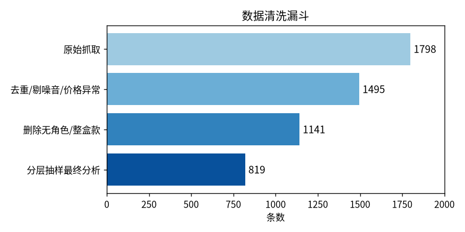
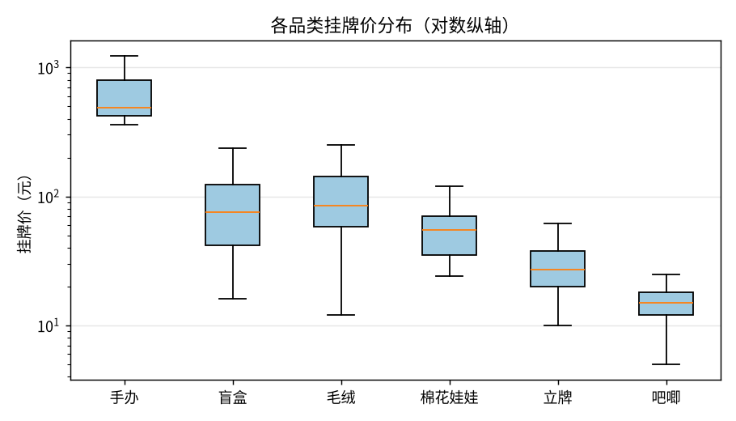
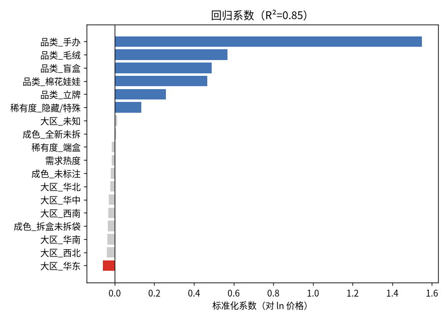
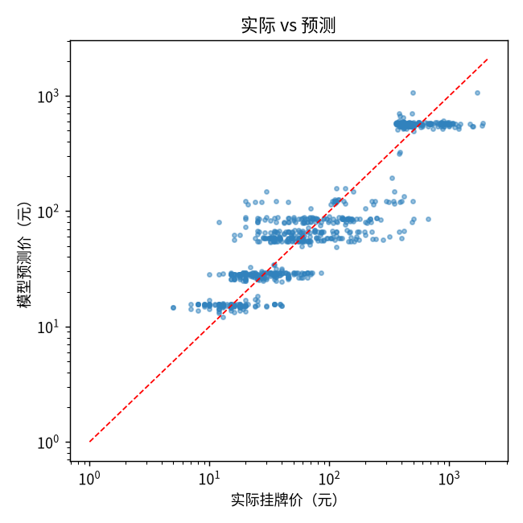

# 二手原神周边挂牌价的决定因素：基于闲鱼 819 条真实挂牌数据的多元线性回归分析

## 1. 研究问题

在二手交易平台闲鱼上，原神（Genshin Impact）周边的挂牌价格由哪些因素决定？

本文用真实抓取的 819 条挂牌记录，检验以下六个候选因素对价格的解释力：

| 候选因素 | 预期方向 |
|---|---|
| F1 品类（手办/盲盒/吧唧/立牌/毛绒/棉花娃娃） | 手办最贵，吧唧最便宜 |
| F2 角色（55+ 官方角色） | 热门角色溢价 |
| F3 稀有度（普通/端盒/隐藏·特殊款） | 隐藏款显著溢价 |
| F4 成色（全新未拆/拆盒未拆袋/仅拆二手） | 成色越差越便宜 |
| F5 卖家所在大区（7 大区） | 沿海/一二线城市略高 |
| F6 需求热度（"X 人想要"） | 越抢手定价越坚挺 |

核心假设：**品类和稀有度主导价格，成色、地区、热度、卖家信用影响很小**。

## 2. 数据来源

- **平台**：闲鱼网页版（goofish.com）
- **抓取方式**：Python + 浏览器自动化，按 6 个搜索关键词各翻 10 页
- **关键词**：原神 手办 / 原神 盲盒 / 原神 吧唧 / 原神 立牌 / 原神 棉花娃娃 / 原神 毛绒
- **抓取时间**：2026 年 11 月
- **原始记录**：1798 条（含商品 ID、标题、价格、卖家地区、"X 人想要"、卖家标签）

选择闲鱼而不是问卷或合成数据，是因为挂牌价是真实市场交易中的报价，能反映卖家真实的定价行为；问卷数据受回忆偏差和社会期望偏差影响，合成数据则缺乏外部效度。

## 3. 数据清洗



| 步骤 | 规则 | 剩余条数 |
|---|---|---|
| R1 | 按商品 ID 去重 | 1798 |
| R2 | 剔除价格缺失、< 5 元或 > 5000 元的异常记录 | ↓ |
| R3 | 剔除服务类噪音（代拍/代购/鉴定/教程/激活码/改娃/手机壳等） | 1495 |
| R4 | 标题须含"原神"或可识别角色名 | ↓ |
| R5 | 删除无法识别具体角色的整盒/系列款 | 1141 |
| R6 | 按品类分层随机抽样（random_state=52） | **819** |

特征工程：

- **角色**：维护 55+ 官方角色词表（含菲林斯、哥伦比娅、夏洛蒂、丝柯克等近期角色），标题正则匹配
- **稀有度**：标题含"隐藏/特殊"=2，含"端盒/整盒"=1，其余=0
- **成色**：按"仅拆/二手 → 全新未拆 → 拆盒未拆袋"顺序匹配（避免"全新未拆封"被误判为拆盒）
- **大区**：卖家省份映射到华东/华北/华南/华中/西南/西北/东北
- **需求热度**：列表页"X 人想要"字段，缺失记 0

## 4. 探索性分析



不同品类的价格量级差异极大：手办中位价约 480 元，而吧唧中位价仅 15 元，差 30 倍。这一量级差异是后续回归中品类系数主导的直观原因。

样本中角色 Top 8：芙宁娜 57、流浪者 45、茜特菈莉 38、甘雨 36、菲林斯 35、枫原万叶 33、魈 33、散兵 32。

## 5. 方法与验证思路

为了更接近日常可理解的结论，我采用的是一个比较直接的流程：

1. 用多元线性回归，同时考虑品类、稀有度、成色、大区、需求热度和卖家标签；
2. 价格先做对数变换（ln），减少极端高价商品对结果的影响；
3. 做 80/20 训练集-测试集划分，避免只看“在原数据上拟合得好不好”；
4. 再做 5 折交叉验证，检查结果是否稳定；
5. 用显著性检验把变量分成“明显有影响”和“影响不稳定”。

这套方法的重点不是复杂推导，而是保证结论“能复现、不过拟合、可解释”。

## 6. 回归结果

| 指标 | 值 |
|---|---|
| 样本量 n | 819 |
| 训练 R² | **0.859** |
| 测试 R² | **0.822** |
| 5 折交叉验证 R² | **0.844 ± 0.020** |
| 模型 | 多元线性回归 |





主要结果可以按“是否显著”来读：

1. 显著正向影响（p<0.05）：手办、毛绒、盲盒、棉花娃娃、立牌、隐藏/特殊款。
2. 不显著变量（p>0.05）：成色、大区、需求热度及其缺失标记、卖家标签（信用相关标签）。
3. 补充验证：对比“含卖家标签”与“不含卖家标签”的模型，测试集 R² 仅提升约 0.0006，可认为几乎没有实际增益。

这意味着：不同商品类型和稀有度确实影响挂牌价格；而成色、地区、热度和卖家信用标签在本样本里没有稳定影响。

## 7. 结论与实际意义

**7.1 最主要的结论**

在控制其他变量后，品类差异和稀有度差异依然最明显。简单说：同样是原神周边，不同品类本来就处在不同价格带，隐藏/特殊款会有额外溢价。

**7.2 四个“看起来有道理，但数据不支持”的点**

1. 成色没有表现出稳定影响；
2. 不同大区之间没有明显价差；
3. "X 人想要"与挂牌价关系很弱。
4. 卖家信用相关标签（如“百分百好评”“卖家信用极好”）对挂牌价影响不显著。

这些结果更像是在说：挂牌价主要由“商品属性”决定，而不是由“卖家在哪”或“页面热度高不高”决定。

**7.3 对交易的启发**

- 买家：优先比较同品类同稀有度的价格，不要只盯"全新未拆"标签。
- 卖家：先看同类商品区间，再定价；不要把"想要人数"当作定价依据。

## 8. 局限与下一步

1. **挂牌价 ≠ 成交价**。卖家报价有一厢情愿成分，未来应抓"已售"数据；
2. **需求热度缺失约 47%**（列表页不展示），虽然已加缺失标记列，但仍可能带来偏差；
3. **未控制时间维度**：新品发售期价格波动大，未来可抓时间序列看价格衰减曲线；
4. **角色作为 one-hot 维度高**，未来可用"角色人气分"（如投票排名）替代；
5. **样本来自单一平台**，结论外推到线下/其他平台需谨慎。

## 复现

```bash
pip install -r requirements.txt
playwright install chromium
python code/crawler.py     # 抓取（需登录闲鱼）
python code/clean.py       # 清洗到 819 条
python code/regression.py  # 回归，输出训练/测试/CV 与显著性
```

数据：`data/processed/genshin_pricing_819.csv`（819 条），原始抓取见 `data/raw/`。
